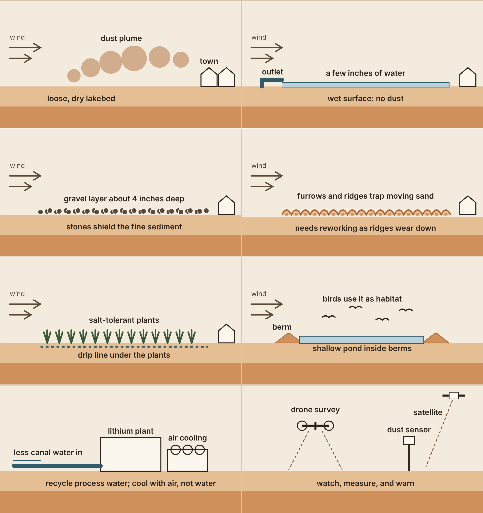

# Solutions and case studies

## Solutions compared

Ratings are rough and qualitative, drawn from Owens Lake (LADWP; National Academies 2020) and the state
Salton Sea Management Program. None was measured at the Salton Sea.

| Solution | Water use | Dust control | Habitat value | Cost and upkeep | Main drawback |
|---|---|---|---|---|---|
| Shallow flooding | High | Very high | Some | High, ongoing | Uses the most water of any method |
| Gravel cover (~4 in.) | None | High | Little | High to build, low to keep | Large amounts of rock; machinery can damage cultural sites |
| Surface roughening (furrows) | Low | Medium | Little | Medium, recurring | Ridges wear down; paired with water backup at Owens Lake |
| Managed vegetation | Medium | Medium to high | Good | Medium, slow | Years to establish; salty soils |
| Habitat ponds | Medium to high | High where built | Very good | High | Slow: about 16% of the state's 2028 goal done |
| Low-water lithium plants | Reduces demand | Indirect | None | Higher plant cost | Air cooling costs more and loses efficiency in heat |
| Monitoring network | None | None by itself | None | Low to medium | Only helps if someone acts on it |

No single option wins. A realistic plan mixes water-free methods where dust reaches the most people, habitat
ponds where water allows, and monitoring everywhere.

## Case studies

| Place | What happened | Drawbacks | Lesson | Source |
|---|---|---|---|---|
| Owens Lake, CA | 48.6 sq mi controlled; 99.4% cut in dust emissions; exceedance days at near-lake monitors 49 (2002) → 8 (2018) | > $2.5 billion; ~60,000 acre-ft/yr; ~31% of LA's fresh water on average since 2007 | Works, but thirsty; target the patches that reach people | [LADWP](https://ladwp.com/who-we-are/water-system/los-angeles-aqueduct/owens-lake); [NASEM 2020](https://nap.nationalacademies.org/read/25658/chapter/2) |
| Drones at Owens Lake | Air district flies drones 1.5–3 ft over treated lakebed to test for dust; elevation and vegetation mapping | Hobby drones failed; recalibration per payload; vendor case study only | Closest precedent for this plan's drone work | [Draganfly (vendor)](https://draganfly.com/wp-content/uploads/2020/05/Case-Study-Great-Basin-Unified-Air-Pollution-Control-District.pdf) |
| Salton Sea dust sources (UC Riverside) | Playa (lakebed-like) dust ~9% of PM10 on average (~12% summer, ~5% winter); crustal dust ~45%; lakebed share expected to rise | ~2.5 weeks sampled (Aug 2015, Feb 2016) at Salton City and Bombay Beach; no dust storms | Need storm-day, multi-site source data | [Frie et al. 2017](https://doi.org/10.1021/acs.est.7b01773) |
| Salton Sea Management Program | 4,782 of 29,800 acres by 2028 (~16%); 2,425 acres of dust suppression | Far behind; dashboard totals inconsistent | Model mitigation as late or partial | [SSMP dashboard](https://projects.saltonsea.ca.gov/Results/ProgressDashboard) |
| Salton Sea geothermal field | Earthquake rates track fluid pumped and injected (1981–2012); largest M5.1 | Near the San Andreas; large-quake link plausible, not established | Add ground and seismic monitoring | [Brodsky & Lajoie 2013, Science](https://doi.org/10.1126/science.1239213) |
| Upper Rhine, Germany | Vulcan Lionheart: 24,000 t/yr lithium hydroxide monohydrate plus 275 GWh/yr power and 560 GWh/yr heat; construction began Dec 2025; €2.2B financing closed May 2026 | 2009 Landau quakes (largest ML 2.7); shaking reached the DIN 4150-3 guideline for sensitive buildings; hairline plaster cracks reported, cause disputed; not yet producing | Set monitoring and liability rules before projects start | [Vulcan ASX (28 May 2026)](https://announcements.asx.com.au/asxpdf/20260528/pdf/0701dgrqknc4b9.pdf); [Groos et al. 2013](https://publikationen.bibliothek.kit.edu/1000038446) |
| Salar de Atacama, Chile | Mining < 10% of fresh water use, but basin use exceeds resupply; much water ≥ 60 years old | Different method (evaporation ponds); long-running community disputes | Judge the whole basin; monitor for decades | [Moran et al. 2022 (summary)](https://www.sciencedaily.com/releases/2022/07/220712102624.htm) |
| Smackover, Arkansas | 2.5% royalty on brine lithium, price-linked (2025) | Swings with prices; set by output, not exposure | Revenue design decides who benefits | [Fastmarkets (2025)](https://www.fastmarkets.com/insights/smackover-lithium-projects/) |

Weaker sources to replace with originals before formal use: the drone vendor case study, the Vulcan financial-news
article, and secondary summaries of the UC Riverside and Atacama studies.
