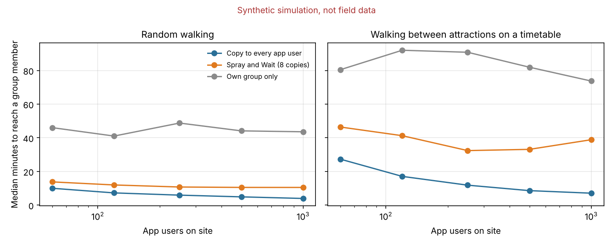

# Lost in the Crowd: Can Phones Carry Messages When the Network Fails?

Research plan, code and data by Jhoven (Johan) Fernandez, part of *GeoAI for Cities* (draft, November 2026).

People lose each other in crowds, and crowds are where phone networks fail first. It happens at a stadium letting
out, a parade, a packed beach, an evacuation, or a blackout that takes the cell towers down with it. This project
asks whether phones can pass sealed messages hand to hand through a crowd, with no network, until "I'm lost, I'm
here" reaches the right few people. It also asks whether knowing how crowds move can make that work better.

I first built and used this idea in a group-finding app at large music festivals, which are temporary cities with
poor signal and a timetable that moves the crowd. The research question is general.



## The question, as a chain

```
How people move around a site → who comes within radio range of whom → how fast a sealed message spreads → does "I'm lost" reach my group in time
```

## What is done and what is planned

| Part | Status |
|---|---|
| Relay design: sealed group messages with an expiry and a hop limit | **Designed, partly built**, described in general terms in `docs/PROPOSAL.md` |
| Rule-based spatial features: distance and direction to a friend, places described in words, walk times, time near places | **Built** (`docs/SPATIAL_METHODS.md`) |
| Audit of official site maps for 97 large events | **Done** (totals in `data/venue_map_audit.json`) |
| Relay simulation: 3 forwarding schemes × 2 movement models | **First synthetic run (Nov 2026)**: the pipeline works and shows which assumptions matter. No field data. |
| GeoAI: a lost person's likely position, crowd density over time, meeting points | **Planned**, not built |
| Field test with 2–4 iPhones | **Planned** (`docs/PROPOSAL.md`, section 5) |

## What I found so far

These come from a toy simulation and a map audit, not from a real crowd.

- **How people move matters.** When people move between attractions on a timetable, messages were slower at every
  crowd size than with random walking. The median was 27 vs 10 minutes with 60 app users, and 7 vs 4 with 1,000.
  The gap is biggest when few people have the app. People cluster and the clusters don't mix until the next move.
  Random walking, the default in most relay studies, makes relays look better than they would be.
- **Strangers do most of the work.** When only your own group can carry a message, 27–42% of messages never
  arrived within 6 hours under timetable movement. The rest took a median of 74–92 minutes. With every app user
  carrying, every message arrived, in a median of 7–27 minutes depending on how many people had the app.
- **Spray and Wait is a fair trade.** It keeps each message on about 10 phones instead of every phone. It took
  1.4–5.6 times as long as copying to everyone but still delivered 98–100%. The gap grows with more app users,
  because copying to everyone keeps getting faster and Spray and Wait doesn't.
- **Radio range is the assumption that matters most.** Going from 30 m to 10 m roughly tripled the median time
  (17 to 50 minutes). At 5 m, 17% of messages never arrived. I don't know the real phone-to-phone range in a dense
  crowd, and it has to be measured, not assumed.
- **Official site maps can't be used as GPS maps.** Of 97 large events, 24 had an official map I could find. None
  was geographically calibrated, and none allowed offline reuse. Any spatial model here starts from a data gap.

## What this is not

- The site is a made-up 900 × 600 m rectangle with 5 attractions. Radio range, walking speed and popularity are guesses.
- The expiry and hop limit in the simulation are example values, not those of any shipped app.
- The simulation leaves out interference, battery, phones going to sleep and session limits.
- The spatial features are geometry and hand-set rules. There is no trained model yet.
- No app source code is in this repository.

## Repository layout

```
research/lost-in-the-crowd/
├── README.md                this file
├── requirements.txt         numpy, scipy, matplotlib
├── code/
│   ├── relay_sim.py         store-carry-forward simulation (synthetic)
│   └── plot_sim.py          summary table and chart
├── data/
│   ├── sim_results.json     every run, with the assumptions used
│   ├── sim_summary.md       the tables behind the findings above
│   ├── sim_log.txt          console output of the last run
│   └── venue_map_audit.json totals from the 97-event map audit
├── docs/
│   ├── PROPOSAL.md          research proposal background: background, privacy questions, open questions, evaluation, supervisors, references
│   ├── SPATIAL_METHODS.md   what is built with location, and where GeoAI would come in
│   └── SIMULATION.md        how the simulation works and what it leaves out
└── media/
    └── sim_latency.png
```

## How to run

```bash
pip install -r requirements.txt
cd code
python relay_sim.py --quick   # about 20 seconds
python relay_sim.py           # about 2 minutes, 3 seeds
python plot_sim.py
```

## Sources

Full reference list in `docs/PROPOSAL.md`. Main background: Fall (2003) on delay-tolerant networking; Vahdat and
Becker (2000) on epidemic routing; Spyropoulos et al. (2005) on Spray and Wait; Chaintreau et al. (2006) on how
often people meet; Larsen et al. (2013) on crowd movement at a large festival.
